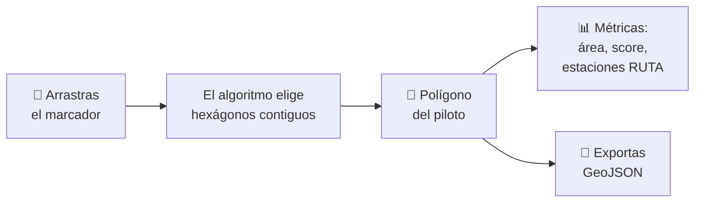
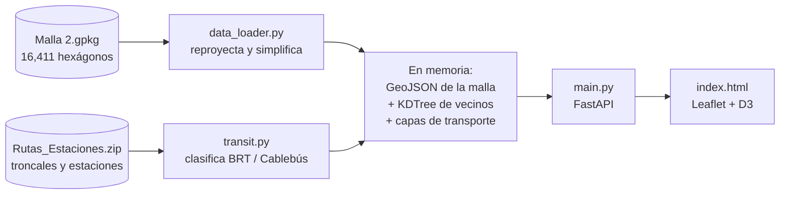
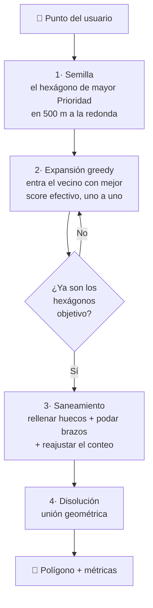

# Guía del explorador de polígonos piloto — SBC Puebla

Manual de uso de la herramienta. Para la documentación técnica de referencia
(rendimiento, decisiones de color, formatos), ver [README.md](README.md).

---

## 1. Qué hace esta herramienta

Responde una pregunta concreta: **si el piloto del Sistema de Bicicletas
Compartidas arranca aquí, ¿qué polígono le toca?**

Pones un marcador en cualquier punto de Puebla y la herramienta arma
automáticamente el área de servicio: elige hexágonos contiguos empezando por los
de mayor prioridad, hasta juntar los que corresponden al número de estaciones y
la densidad que pediste.



Lo que **no** hace: no ubica las estaciones dentro del polígono, no calcula
demanda ni costos. Delimita el área.

---

## 2. Arrancar la herramienta

```bash
cd "/Users/mike/Documents/ITDP/ACCESS/SBC Puebla"
.venv/bin/uvicorn main:app --port 8000
```

Abrir <http://127.0.0.1:8000>. Para detenerla: `Ctrl+C` en esa terminal.

La primera carga tarda unos segundos porque descarga los 16,411 hexágonos
(~694 KB comprimidos). Después todo es instantáneo.

> Si ves una versión vieja, recarga con `Cmd+Shift+R`.

---

## 3. La pantalla de un vistazo

```
┌──────────────────────────────────────────┬─────────────────────────┐
│                                          │  Polígonos piloto       │
│                                       ◐  │  ─────────────────────  │
│                                          │  1. Mapa base           │
│         MAPA                             │  2. Tamaño del piloto   │
│                                          │  3. Compacidad (λ)      │
│    🔷 polígono del piloto                │  4. Escenarios          │
│    ⬤  marcador arrastrable               │  ⚠  Avisos              │
│    ▬▬ RUTA (BRT)                         │  5. Métricas            │
│    ▬ ▬ Cablebús                          │  6. Comparación         │
│    ⬡  malla de 16,411 hexágonos          │  7. Score por variable  │
│                                          │  8. Perfil del hexágono │
│                                          │  9. Variable en el mapa │
└──────────────────────────────────────────┴─────────────────────────┘
```

**Dos gestos básicos:**

| Gesto | Resultado |
|---|---|
| Arrastrar el marcador numerado | Reconstruye ese polígono en el nuevo centro |
| Clic en cualquier hexágono | Abre su ficha (popup + panel lateral) |

El botón **◐** de la esquina superior derecha alterna tema claro/oscuro.

---

## 4. El panel, sección por sección

### 1. Mapa base

Cinco fondos, según lo que necesites ver debajo de la malla:

| Opción | Para qué sirve |
|---|---|
| **Claro** / **Oscuro** | Neutros. El mejor contraste para leer los colores de prioridad |
| **Calles y negocios** | OpenStreetMap: comercios, escuelas, puntos de interés |
| **Colonias** | Calles, nombres y zonas, sin saturar la vista |
| **Satélite** | Imagen real del terreno |

**Opacidad de la malla** — el control más útil de esta sección. Bájalo a
30–50% para ver calles y referencias *a través* de los hexágonos y ubicar de
qué colonias estás hablando. La malla se atenúa en vivo mientras arrastras.

**Mostrar RUTA y Cablebús** — dibuja las troncales como referencia:

- **RUTA (BRT)** — línea negra continua, estaciones redondas (153 estaciones)
- **Cablebús** — línea morada discontinua, estaciones cuadradas (9 estaciones)

Pasa el cursor sobre una línea o estación para ver su nombre y línea.

### 2. Tamaño del piloto

Dos deslizadores que definen cuántos hexágonos entran al polígono:

| Control | Rango | Qué significa |
|---|---|---|
| **Densidad** | 7 – 12 est/km² | Qué tan juntas van las estaciones |
| **Estaciones** | 100 – 150 | Cuántas estaciones tendrá el piloto |

El número de hexágonos **se deriva** de esos dos y aparece debajo en vivo:

```
hexágonos = estaciones ÷ densidad ÷ 0.0541 km²
```

Cubre desde **154 hexágonos (8.3 km²)** con 100 estaciones a 12/km², hasta
**396 hexágonos (21.4 km²)** con 150 estaciones a 7/km².

El botón **Sistema completo · 137 est · 10/km²** vuelve al caso de referencia
del estudio (253 hexágonos, 13.69 km²).

> El polígono se recalcula **al soltar** el deslizador, no mientras lo
> arrastras. Así puedes buscar el valor sin disparar cálculos innecesarios.

### 3. Compacidad (λ)

Controla la forma del polígono. Es el trade-off central de la herramienta:

```
λ = 0.0 ──────────────────────────────────── λ = 1.0
El mejor score posible          La forma más compacta posible
El polígono se estira siguiendo  El polígono se redondea aunque
corredores de alta prioridad     deje fuera algo de score
```

Por defecto **λ = 0.30**. Medido en Cholula a 10 est/km²:

| λ | Compacidad | Score promedio |
|---|---|---|
| 0.0 | 0.199 | 0.658 |
| 0.3 | 0.239 | 0.648 |
| 1.0 | 0.348 | 0.594 |

Subir λ **siempre cuesta score**. Un polígono alargado captura mejores
hexágonos pero es caro de operar: más perímetro, rebalanceo más largo, peor
accesibilidad entre extremos.

### 4. Escenarios

Hasta **3 polígonos simultáneos**, cada uno con su marcador, su densidad, su
número de estaciones y su λ. Sirve para comparar alternativas lado a lado.

| Color | Escenario |
|---|---|
| 🟧 Naranja | Escenario 1 |
| 🟩 Aqua | Escenario 2 |
| 🟪 Violeta | Escenario 3 |

- **+ Agregar escenario** — crea uno nuevo, desplazado y heredando los ajustes
  del activo
- **↓ Exportar GeoJSON** — descarga el escenario activo (contorno + los
  hexágonos que lo forman + todas las métricas). Abre directo en QGIS
- **⤢ Encuadrar** — centra el mapa en el escenario activo
- **⤢ Toda la malla** — vuelve a la vista completa

Haz clic en una tarjeta de escenario para activarlo; los deslizadores del panel
pasan a operar sobre ése.

### ⚠ Avisos

Aparecen solo cuando algo merece atención:

| Aviso | Qué significa |
|---|---|
| Polígono poco compacto | Compacidad < 0.18. Considera subir λ |
| Hexágonos unidos por 2 lados | Quedó un hexágono de borde asomado. Mover un poco el centroide suele resolverlo |
| Semilla tomada a X m | El punto cayó lejos de la malla; se buscó más lejos |

### 5. Métricas del polígono activo

| Métrica | Cómo leerla |
|---|---|
| **Área** | km² del polígono construido |
| **Hexágonos** | Los que entraron / los que se pidieron. Deben coincidir |
| **Score promedio** | Prioridad media de 1.90 posible. Compárala con 0.217, el promedio de toda la malla |
| **Rango de score** | Mínimo y máximo dentro del polígono |
| **Estaciones SBC** | Las que caben / las que pediste |
| **Compacidad** | Polsby-Popper: 1.0 = círculo perfecto, 0.1 = muy alargado |
| **Estaciones RUTA** | Cuántas de las 153 del BRT caen dentro |
| **Estaciones Cablebús** | Cuántas de las 9 caen dentro |

Las dos últimas son el indicador de **integración multimodal**: cuánto del
transporte masivo alimentaría el piloto.

### 6. Comparación de escenarios

Aparece sola en cuanto tienes 2 o más. Es una tabla con todas las métricas
lado a lado — la forma más rápida de justificar por qué elegiste un centroide.

### 7. Score promedio por variable

Desglosa de dónde viene el score del polígono. Siete barras que **suman
exactamente** el score promedio:

| Variable | Aporte máximo |
|---|---|
| Transporte masivo (RUTA) | 0.50 |
| Empleo | 0.40 |
| Infraestructura ciclista | 0.30 |
| Densidad poblacional | 0.20 |
| Áreas verdes | 0.20 |
| Atractivo turístico | 0.20 |
| Escuelas | 0.20 |

La barra llena es el promedio del polígono; la pista clara detrás, el máximo
que esa variable puede aportar. Una barra casi llena significa que el polígono
ya está aprovechando esa variable al tope.

### 8. Perfil del hexágono

Se llena al hacer **clic en cualquier hexágono** del mapa. Muestra sus siete
variables y, como referencia, una marca vertical **│** con el promedio del
polígono activo — así ves de un golpe si ese hexágono está por encima o por
debajo de su entorno.

Simultáneamente se abre un popup en el mapa con lo mismo. Se cierra con su ✕
o al hacer clic en otro hexágono.

### 9. Variable en el mapa

Cambia lo que colorea el choropleth: el **score total** o cualquiera de las
**siete variables por separado**.

En modo score total, seis clases:

| Color | Prioridad |
|---|---|
| ⬜ Gris | = 0 |
| 🟦 Azul | 0 – 1.0 |
| 🟩 Verde | 1.0 – 1.2 |
| 🟨 Amarillo | 1.2 – 1.4 |
| 🟧 Naranja | 1.4 – 1.6 |
| 🟥 Rojo | ≥ 1.6 |

En modo variable, tres clases — porque **cada variable individual solo toma
tres valores**: sin aporte, aporte medio, aporte alto.

Debajo, el **histograma** muestra la distribución del score en toda la malla.
Arrastra sobre él para mostrar en el mapa solo los hexágonos de ese rango
(útil para aislar la zona de alta prioridad). **Limpiar filtro** lo quita.

---

## 5. Recetas de trabajo

### Encontrar el mejor centroide para el piloto

1. Deja la vista en **Score total** y sube la opacidad al 80%
2. Localiza a ojo la mancha roja/naranja más grande y compacta
3. Arrastra el marcador ahí y compara el **score promedio** contra 0.217
   (promedio de la malla)
4. Prueba 2–3 posiciones más como escenarios separados
5. Decide con la **tabla de comparación**

### Ver qué colonias quedan dentro

1. Mapa base **Colonias** (o **Calles y negocios**)
2. Opacidad de la malla al **30–40%**
3. **⤢ Encuadrar** para acercarte al polígono

### Evaluar la integración con transporte masivo

1. Activa **Mostrar RUTA y Cablebús**
2. Lee **Estaciones RUTA** y **Estaciones Cablebús** en las métricas
3. Prueba mover el centroide hacia una troncal y ve cómo cambian

### Entender por qué una zona tiene score alto

1. Cambia **Variable en el mapa** entre las siete opciones
2. Observa cuál "enciende" esa zona
3. Confirma con clic en un hexágono concreto

### Ajustar la forma para que sea operable

1. Mira la **compacidad** en las métricas
2. Si está por debajo de ~0.20, sube **λ** en pasos de 0.1
3. Vigila cuánto score pierdes en cada paso — el trade-off está en la tabla
   de comparación si guardas escenarios

---

## 6. Cómo se construyó

### Arquitectura



Todo lo caro ocurre **una sola vez, al arrancar** (~0.5 s): leer el
GeoPackage, reproyectar, simplificar y calcular los 48,254 pares de vecinos a
≤260 m. Después, cada interacción solo consulta lo que ya está en memoria —
por eso el polígono se reconstruye en milisegundos y el archivo original nunca
se vuelve a abrir.

**Endpoints:**

| Endpoint | Devuelve |
|---|---|
| `GET /meta` | Rangos, variables, histograma. Arranca el frontend |
| `GET /data` | Los 16,411 hexágonos con score y variables |
| `GET /transit` | Troncales RUTA y Cablebús + estaciones |
| `POST /polygon` | El polígono construido + métricas |
| `GET /hex/{id}` | Ficha completa de un hexágono |

### El algoritmo, paso a paso



**El score efectivo** es la fórmula que decide qué hexágono entra:

```
score_efectivo = Prioridad
               − λ × (distancia al centroide ÷ 2,500 m)     ← compacidad
               + 0.35 × (lados que ya tocan el cluster ÷ 6)  ← cohesión
```

- El término de **λ** es el deslizador de Compacidad: penaliza alejarse.
- El término de **cohesión** premia rellenar concavidades antes de estirar
  tentáculos. No es ajustable; es lo que mantiene sanas las formas.

### Por qué no "los N mejores hexágonos"

La forma obvia de armar el polígono sería tomar los 253 hexágonos de mayor
score dentro de un radio. **No funciona**: quedan manchas dispersas sin
conexión entre sí, que no son un área de servicio.

```
  Top-N por score              Expansión greedy
   ⬡⬡   ⬡      ⬡                    ⬡⬡⬡
     ⬡     ⬡⬡                      ⬡⬡⬡⬡⬡
   ⬡   ⬡⬡    ⬡                     ⬡⬡⬡⬡⬡⬡
     ⬡⬡   ⬡                         ⬡⬡⬡⬡⬡
   ✗ desconectado                  ✓ contiguo
```

La contigüidad está **garantizada por construcción**: un hexágono solo puede
entrar si ya es vecino de alguno que está dentro. Dos hexágonos son vecinos si
sus centros distan ≤ 260 m (el espaciado real es de 250 m exactos).

### Por qué hizo falta sanear la forma

El greedy puro dejaba dos problemas que **no son operables en calle**:

```
      HUECO                    BRAZO DE 1 HEXÁGONO
    ⬡⬡⬡⬡⬡                        ⬡⬡⬡⬡⬡
    ⬡⬡ ⬡⬡⬡    ← bolsillo de      ⬡⬡⬡⬡⬡⬡
    ⬡⬡⬡⬡⬡        prioridad        ⬡⬡⬡⬡⬡  ⬡ ← asomado
    ⬡⬡⬡⬡⬡        baja que          ⬡⬡⬡   ⬡    por 2 lados
                 quedó rodeado           ⬡
```

Subir λ **no los resolvía**: λ es una presión global de forma, mientras que
ambos defectos son locales. Incluso en λ = 1.0 quedaban huecos.

La solución tiene dos partes: el término de cohesión mientras crece, y al
terminar un ciclo de **rellenar huecos → podar hexágonos unidos por menos de
3 lados → reajustar al conteo exacto**, repetido hasta que sea estable.

Podar por debajo de 3 contactos fija el **grosor mínimo en 2 hexágonos
(~500 m)**, que es el criterio operativo del piloto.

Resultado, medido sobre 200 centroides aleatorios:

| | Antes | Ahora |
|---|---|---|
| Huecos | sí, hasta 3 | **0 en los 200** |
| Polígonos fragmentados | posibles | **0 en los 200** |
| Conteo exacto | sí | **200 / 200** |
| Compacidad (Centro, λ=0.2) | 0.114 | **0.367** |

**El costo, que conviene tener presente:** rellenar un hueco obliga a incluir
hexágonos de baja prioridad. El score mínimo del polígono baja de ~1.25 a
~1.00 y el promedio cae ~2.7%. Es inevitable — no se puede operar una dona.

### De dónde salen los datos

**La malla** (`Malla 2.gpkg`, capa `malla_prueba_2`): 16,411 hexágonos de
0.0541 km², centros separados 250 m exactos, en EPSG:6657.

`Prioridad` es la **suma exacta** de las siete variables ponderadas. Cada
variable viene de un puntaje crudo de 0, 1 o 2, de ahí que en la vista por
variable solo haya tres clases.

**Las troncales** (`insumosAPP/Rutas_Estaciones.zip`): 7 líneas ya tipificadas
como BRT o Teleférico. Las 162 estaciones **no** traían tipo, pero se
clasifican solas: las de BRT declaran su línea, y las 9 restantes caen a menos
de un metro de la traza del teleférico. Sus nombres coinciden uno a uno con las
9 estaciones anunciadas del Cablebús.

---

## 7. Límites conocidos

| Límite | Detalle |
|---|---|
| **No hay municipio en los datos** | La malla no trae esa columna. Usa el mapa base **Colonias** para ubicarte |
| **Un hexágono asomado, a veces** | En ~2% de los centroides queda un hexágono unido por 2 lados. Exigir un conteo *exacto* lo hace geométricamente inevitable. Mover un poco el centroide lo resuelve |
| **Google Maps no está disponible** | Sus teselas exigen su propio SDK con llave de facturación. **Calles y negocios** (OSM) es el equivalente libre |
| **Score mínimo bajo** | Es consecuencia de no permitir huecos: algunos hexágonos de baja prioridad entran por fuerza geométrica |
| **La herramienta es local** | Corre solo en tu máquina mientras el servidor esté encendido |
